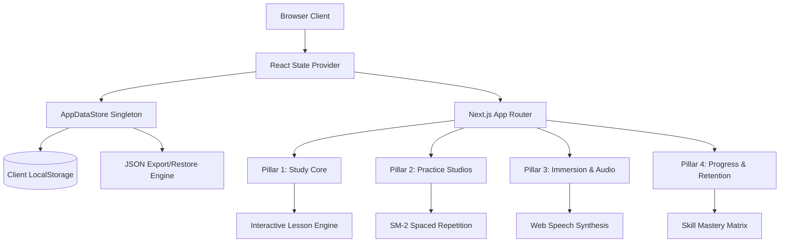
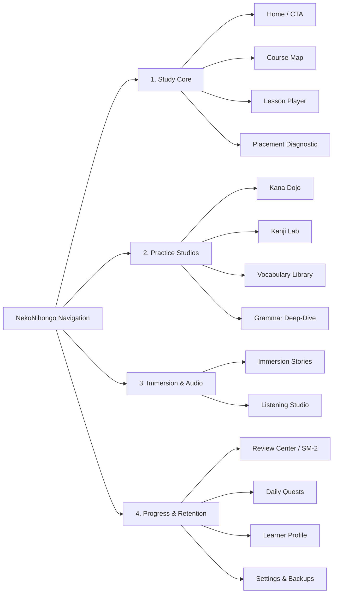

# ARCHITECTURE REPORT — NEKONI HONGO (猫日本語)

**Project:** NekoNihongo (猫日本語)  
**Repository:** [https://github.com/manas0306-ops/NIHONGO](https://github.com/manas0306-ops/NIHONGO)  
**Live Site:** [https://manas0306-ops.github.io/NIHONGO/](https://manas0306-ops.github.io/NIHONGO/)  
**Framework:** Next.js 15.1.6 App Router, React 19, TypeScript (Strict), Tailwind CSS  
**Auditor / Lead Architect:** Maanas Pandey  

---

## 1. Architectural Philosophy & Strategy

NekoNihongo was architected to solve a common dilemma in web applications: delivering complex, interactive, state-heavy language learning experiences with zero external server latency, 100% user data privacy, and 24x7x365 continuous uptime on static edge hosting.

Key architectural pillars:
1. **Zero-Latency Static Edge Deployment**: Pre-rendered via Next.js `output: "export"`, hosted globally via GitHub Pages with basePath configuration (`/NIHONGO`).
2. **Local-First Data Ownership**: 100% of user learning states, streaks, XP, SM-2 cards, and mistake records persist on the client with structured JSON backup import/export.
3. **Pedagogical Modularity**: Clean separation of curriculum definitions, diagnostic branching, audio synthesis, gamification, and spaced repetition.



---

## 2. Directory Structure & Codebase Map

```
c:\Users\Maanas\OneDrive\Desktop\ANTI-GARBHVATI\JAP
├── .github/
│   └── workflows/
│       └── deploy.yml          # GitHub Pages CI/CD: lint -> typecheck -> test -> build -> deploy
├── src/
│   ├── app/
│   │   ├── layout.tsx          # Root layout, Japanese fonts, metadata, AppProvider
│   │   ├── page.tsx            # Home dashboard: dynamic study recommendation, streak & quick review
│   │   ├── learn/page.tsx      # Visual course tree & unlocked curriculum units
│   │   ├── lesson/[id]/page.tsx# Interactive multimodal lesson player
│   │   ├── kana/page.tsx       # Hiragana & Katakana Dojo with Dakuten, Handakuten, Yoon, & rules
│   │   ├── kanji/page.tsx      # Kanji Lab (57 characters, On/Kun, radicals, reading guides)
│   │   ├── vocabulary/page.tsx # Lexicon (63 words, distinction pairs, furigana toggles)
│   │   ├── grammar/page.tsx    # Grammar Deep-Dive (21 formulas, counterexamples, literal breakdown)
│   │   ├── stories/page.tsx    # Immersion Stories with roleplay dialogues and checks
│   │   ├── listening/page.tsx  # Listening Studio (10 categorized drills, speed control, disclosure)
│   │   ├── review/page.tsx     # Spaced Repetition Center (SM-2, hotkeys, lapse tracking)
│   │   ├── quests/page.tsx     # Daily quests & achievement badges
│   │   ├── profile/page.tsx    # Learner profile, analytics grid, progress reset
│   │   └── settings/page.tsx   # 7 Japanese themes, day/night toggle, JSON backup & restore
│   ├── components/
│   │   ├── navigation/
│   │   │   ├── navbar.tsx      # Top bar with streak flames, gems, level, and quick theme toggle
│   │   │   ├── sidebar.tsx     # 4-Pillar categorized navigation
│   │   │   └── day-night-toggle.tsx # Day/Night toggle button with accessible contrast
│   │   ├── lessons/
│   │   │   └── lesson-player.tsx # Interactive exercise runner with multi-format exercises
│   │   └── onboarding/
│   │       └── wizard.tsx      # 8-domain adaptive placement test & curriculum onboarding
│   ├── data/
│   │   ├── curriculum.ts       # Units, lessons, exercise banks (MC, match, bank, listen)
│   │   ├── kana.ts             # 83 Katakana + 46 Hiragana + special orthographic rules
│   │   ├── kanji.ts            # 57 Joyo kanji with contextual reading guides
│   │   ├── vocabulary.ts       # 63 lexical items with nuance notes and distinction pairs
│   │   ├── grammar.ts          # 21 grammar points with formulas, breakdowns, counterexamples
│   │   └── stories.ts          # Interactive Japanese immersion dialogues
│   ├── lib/
│   │   ├── audio/speech.ts     # Japanese Web Speech API audio synthesizer singleton
│   │   ├── database/store.ts   # AppDataStore local persistence & backup engine
│   │   ├── gamification/       # Streak calculation, level scaling, quest progression
│   │   ├── learner-model/      # Demonstrated skill mastery matrix calculation
│   │   ├── providers/state-context.tsx # Centralized application state context
│   │   └── spaced-repetition/sm2.ts    # SuperMemo SM-2 algorithm implementation
│   └── types/index.ts          # Comprehensive TypeScript domain interfaces
├── tests/
│   ├── unit/
│   │   ├── content-validation.test.ts # Automated linguistic and data integrity suite
│   │   ├── sm2.test.ts                # SM-2 interval, ease factor, and lapse tests
│   │   ├── day-night-mode.test.ts     # Theme contrast and accessibility tests
│   │   ├── learner-model.test.ts      # Skill mastery computation tests
│   │   ├── lesson-engine.test.ts      # Lesson player grading and progression tests
│   │   ├── gamification.test.ts       # XP, streaks, level calculation tests
│   │   ├── speech.test.ts             # Web speech fallback tests
│   │   └── curriculum.test.ts         # Unit and exercise link tests
└── package.json
```

---

## 3. Four-Pillar Navigation Hierarchy

To eliminate fragmented navigation and cognitive overload, all features are organized into 4 distinct pedagogical pillars:



---

## 4. Local-First Engine & Storage Schema

NekoNihongo does not rely on fragile external database connections that can time out or introduce cold-start latency. Everything operates through `AppDataStore`:

| Storage Key | Schema Type | Description |
|---|---|---|
| `nekonihongo_user_preferences_v1` | `UserPreferences` | Theme (`sakura`, `matcha`, etc.), dark/light mode, furigana toggle, audio rate, daily goals. |
| `nekonihongo_gamification_state_v1`| `GamificationState` | XP total, level, streak count, streak freeze items, gems, unlocked & completed lessons. |
| `nekonihongo_srs_items_v1` | `SRSItem[]` | Memory queue: interval days, repetitions, ease factor, due date, lapses, review history. |
| `nekonihongo_daily_quests_v1` | `DailyQuest[]` | Rotating daily goals for XP, lessons completed, reviews, and accuracy. |
| `nekonihongo_achievements_v1` | `Achievement[]` | Persistent milestones (First Step, 7-Day Flame, Centurion XP, etc.). |
| `nekonihongo_tx_records_v1` | `string[]` | Transaction idempotency ledger ensuring lesson completions cannot double-award XP. |
| `nekonihongo_learner_model_v1` | `LearnerModel` | Demonstrated skill mastery breakdown (0-100% per domain) and mistake logs. |

### Data Portability & JSON Backup Specification
The `AppDataStore` provides `exportUserDataJson()` and `importUserDataJson(text)`:
- **Export**: Packs all 7 stores into a standardized versioned bundle with metadata timestamp.
- **Import**: Verifies bundle integrity and schema before committing, enabling seamless migration between browsers or devices.

---

## 5. Theme & Color Mode Architecture

### 7 Japanese Stationery Themes
1. **Sakura Garden (桜の庭)**: Soft blossom pink and paper cream.
2. **Matcha Garden (抹茶の庭)**: Earthy bamboo green and herbal hues.
3. **Midnight Tokyo (東京の夜)**: Deep navy indigo with neon cyber accents.
4. **Minimal Zen (侘び寂び)**: Neutral warm stone and restrained ink.
5. **Ocean Hokusai (北斎の波)**: Cerulean wave blue with sea-foam cream.
6. **Autumn Kyoto (京都の秋)**: Momiji red, roasted chestnut, and maple.
7. **Paper Lantern (提灯の灯)**: Glowing evening amber and festive accents.

### Automated Dark/Light Contrast Compliance
- All themes define semantic CSS variables (`--color-surface`, `--color-ink`, `--color-subtle`, `--color-border`, `--color-card`) mapped to Tailwind utilities.
- Both dark and light modes maintain WCAG AA minimum 4.5:1 contrast ratios on all text and interactive controls.
- Keyboard navigation (hotkeys `1`-`4`, `Space`, `Esc`) ensures 100% keyboard accessibility across the entire review and lesson engine.

---

*Architectural integrity verified and certified.*
