# NekoNihongo (猫日本語) — Baseline Comprehensive Codebase Audit Report

**Date of Audit**: November 1, 2026  
**Repository**: [https://github.com/manas0306-ops/NIHONGO](https://github.com/manas0306-ops/NIHONGO)  
**Live Site**: [https://manas0306-ops.github.io/NIHONGO/](https://manas0306-ops.github.io/NIHONGO/)  
**Lead Auditor**: Senior Full-Stack Engineer, Product Architect & Japanese Pedagogical Specialist

---

## 1. Executive Summary

A comprehensive, zero-assumption audit of the NekoNihongo codebase was conducted spanning Next.js 15 App Router configuration, TypeScript strictness, data schemas, audio synthesis and recognition, SuperMemo SM-2 spaced repetition calculations, placement assessment logic, curriculum integrity, user state persistence, theme contrast, security posture, and GitHub Pages deployment workflow.

The core application shell is clean, robust, and performs fast client-side rendering with 105 kB first-load shared JavaScript. However, this deep audit identified **11 critical defects, inconsistencies, and unsupported claims** that must be resolved to meet strict Japanese pedagogical accuracy and production standards:

1. **Katakana Dojo Missing Dakuten, Handakuten & Yōon**: When selecting Katakana and filtering by any category other than Gojūon, the grid renders completely empty because only Gojūon characters exist in `src/data/kana.ts`.
2. **SM-2 Grade Mapping Inconsistency**: The review interface mapped "Forgot" to grade `1` instead of standard SM-2 grade `0`, and item lapse counts were not updated or stored.
3. **Linear Non-Adaptive Placement Test**: The 8-question placement wizard presented a fixed linear list lacking difficulty branching, question difficulty metadata, listening comprehension, sentence construction, or confidence intervals.
4. **Limited Grammar Database**: Only 6 basic patterns existed in `GRAMMAR_DATABASE`, lacking foundational N5/N4 points required by pedagogy (such as が subject marker contrast, から/まで bounds, これ vs この, ある vs いる existence verbs, ない-form, た-form, counters, potential, and keigo registers).
5. **Contextual Kanji & Vocabulary Depth**: 16 kanji and 27 vocabulary items existed with minimal contextual reading notes or distinction between nuanced synonyms (e.g., 見る vs 観る vs 視る).
6. **Supabase Claim vs. LocalStorage Reality**: Documentation claimed Supabase PostgreSQL persistence and cloud synchronization, whereas the app runs 100% locally on `localStorage` without `@supabase/supabase-js` in `package.json`. No backup/restore or IndexedDB fallback existed.
7. **Speaking Studio Transcription vs. Pronunciation**: Need to reinforce that browser Web Speech API provides text transcription matching rather than acoustic pitch-accent spectrograms.
8. **Listening Studio Sample Size**: Only 3 listening drills existed in the dedicated listening studio.
9. **Curriculum Exercise Type Typos in Tests**: `content-validation.test.ts` previously had loose comparisons for exercise types `match_pairs` and `word_bank`.
10. **Keyboard Focus & Input Conflict Prevention**: Pressing `[D]` for Day/Night mode needed checks for all interactive inputs and modals.
11. **Deployment Claims**: "Zero 404 Guarantee" in documentation must be backed by measurable regression tests verifying GitHub Pages SPA routing and 404 redirection.

---

## 2. Verified Architecture Map

```mermaid
graph TD
    User["Learner / Browser Client"] --> Shell["App Router Shell (layout.tsx)"]
    Shell --> Topbar["Topbar (Day/Night, Stats, Theme)"]
    Shell --> Sidebar["4-Pillar Sidebar (Desktop)"]
    Shell --> BottomNav["Categorized BottomNav (Mobile)"]
    Shell --> Routes["16 Core Routes (src/app/*)"]
    
    Routes --> Home["Home Dashboard (3-Question Adaptive Loop)"]
    Routes --> Kana["Kana Dojo (Hiragana/Katakana + Stroke Canvas)"]
    Routes --> Kanji["Kanji Lab (Radicals, Readings & Flashcards)"]
    Routes --> Vocab["Vocabulary Library (Search, Tags, Furigana)"]
    Routes --> Grammar["Grammar Studio (Formulas, Contrasts, Quizzes)"]
    Routes --> Listening["Listening Studio (TTS Speed & Comprehension)"]
    Routes --> Speaking["Speaking Studio (Web Speech & Fallback)"]
    Routes --> Stories["Immersion Stories (Dialogues & Furigana)"]
    Routes --> Review["Review Center (SM-2 Spaced Repetition)"]
    Routes --> Map["Course Map (10 Units, 30 Lessons)"]
    Routes --> Practice["Practice Hub (Micro-Drills)"]
    Routes --> Quests["Quests & Challenges"]
    Routes --> Profile["Profile & Demonstrated Mastery"]
    Routes --> Settings["Preferences & 7 Stationery Themes"]

    Routes --> Player["Lesson Player (20+ Exercise Types)"]
    Player --> Engine["Deterministic Exercise Evaluator"]
    Player --> Audio["JapaneseAudioSynthesizer (Web Speech)"]
    Player --> SRSAuto["Auto Lesson-to-SRS Enrollment"]
    
    Routes --> Context["AppContext / AppProvider (state-context.tsx)"]
    Context --> Store["AppDataStore (store.ts)"]
    Store --> Storage["LocalStorage Engine (nekonihongo_*_v1)"]
    Store --> SM2["SM-2 Algorithmic Scheduler (sm2.ts)"]
    Store --> Model["LearnerModel & Mistake Classifier (model.ts)"]
```

---

## 3. Audited Findings & Defect Classifications

### [DEFECT-01] Katakana Dakuten, Handakuten, and Yōon Missing from `KATAKANA_CHARACTERS`
- **Classification**: `VERIFIED DEFECT`
- **File**: `src/data/kana.ts` (lines 114–180)
- **Component**: `KATAKANA_CHARACTERS`
- **Existing Behavior**: `KATAKANA_CHARACTERS` only contains 46 Gojūon characters. When a learner toggles to Katakana in `KanaDojoPage` and clicks "Dakuten", "Handakuten", or "Yōon", the filtered array is empty (`[]`), resulting in an empty grid with no characters displayed.
- **Expected Behavior**: Katakana should provide complete sets for Dakuten (ガ, ザ, ダ, バ), Handakuten (パ, ピ, プ, ペ, ポ), and Yōon (キャ, シャ, チャ, etc.), matching Hiragana.
- **Severity**: High (P1)
- **Correction**: Populate comprehensive Katakana Dakuten, Handakuten, and Yōon characters with verified romaji, audio keys, stroke counts, and mnemonics.
- **Regression Test**: Test verifying `KATAKANA_CHARACTERS.filter(c => c.category === "dakuten").length >= 20` and `yoon.length >= 12`.

---

### [DEFECT-02] SM-2 Review Interface Rating Inconsistency & Missing Lapse Count
- **Classification**: `VERIFIED INCONSISTENCY`
- **File**: `src/app/review/page.tsx` (lines 136–160) & `src/lib/spaced-repetition/sm2.ts`
- **Component**: `handleGrade` in `ReviewCenterPage`
- **Existing Behavior**: The "Forgot" button passed `grade = 1` into `recordSRSReview` instead of the canonical `grade = 0` (complete recall failure). Furthermore, `SRSItem` lacked explicit lapse tracking (`lapses`), tracking only total incorrect count without distinguishing between first-time learning vs. post-mastery lapses.
- **Expected Behavior**: "Forgot" should pass `0` to signal complete blackout. Each item should explicitly track `lapses` (number of times an item fell out of review/mastered status back to repetition 0).
- **Severity**: Medium (P1)
- **Correction**: Map Forgot=0, Hard=3, Good=4, Easy=5 in `ReviewCenterPage`, update `calculateSM2` to increment `lapses` when an item with `repetitions > 0` receives grade < 3, and persist this in `SRSItem`.
- **Regression Test**: Unit test in `tests/unit/sm2.test.ts` verifying lapse increment on failed recall of previously reviewed items.

---

### [DEFECT-03] Linear Non-Adaptive Placement Assessment
- **Classification**: `VERIFIED INCONSISTENCY`
- **File**: `src/components/onboarding/wizard.tsx` (lines 50–160)
- **Component**: `placementQuestions` & `evaluatePlacementScore`
- **Existing Behavior**: A static sequence of 8 fixed questions was presented regardless of whether the user answered correctly or incorrectly. No skill-by-skill scoring or item difficulty metadata existed.
- **Expected Behavior**: A genuinely adaptive assessment selecting subsequent items based on performance (e.g. promoting to harder questions on correct answers, stepping down to foundational questions on mistakes), tracking domain scores across Hiragana, Katakana, Vocab, Grammar, Kanji, Reading, Listening, and Sentence Construction, and outputting an evidence-based recommendation without claiming official JLPT certification.
- **Severity**: High (P1)
- **Correction**: Implement dynamic difficulty branching across an item bank with question difficulty metadata, skill-wise score profiling, confidence estimates, and transparent placement rationale.
- **Regression Test**: Unit test verifying adaptive progression (harder item selected after correct response; foundational item selected after error).

---

### [DEFECT-04] Insufficient Grammar Database Coverage for Core Japanese Nuances
- **Classification**: `VERIFIED DEFECT`
- **File**: `src/data/grammar.ts`
- **Component**: `GRAMMAR_DATABASE`
- **Existing Behavior**: Only 6 grammar patterns were defined. Essential pedagogical requirements from Phase 2.4 were missing from the database (e.g., が subject marker, から/まで bounds, これ/それ/あれ demonstratives, ある vs いる existence, ない-form negative, た-form past, い/な-adjective conjugations, counters, potential, and keigo).
- **Expected Behavior**: Comprehensive database covering all mandatory N5/N4 core grammar structures with formula, usage conditions, register/politeness, sentence breakdowns, literal vs. natural translations, common pitfalls, and counterexamples.
- **Severity**: High (P1)
- **Correction**: Expand `GRAMMAR_DATABASE` from 6 to 20+ comprehensive grammar entries covering all Phase 2.4 requirements with structured fields.
- **Regression Test**: Expand `tests/unit/content-validation.test.ts` to verify unique IDs, formation, registers, and examples for all entries.

---

### [DEFECT-05] Contextual Kanji & Vocabulary Distinctions
- **Classification**: `IMPROVEMENT`
- **File**: `src/data/kanji.ts` & `src/data/vocabulary.ts`
- **Component**: `KANJI_DATABASE` and `VOCABULARY_DATABASE`
- **Existing Behavior**: `KANJI_DATABASE` contained 16 kanji; `VOCABULARY_DATABASE` contained 27 words. Kanji had examples but lacked explicit contextual reading rules explaining why readings change in compound words (Jukugo) vs. standalone Kun'yomi. Vocabulary lacked nuanced distinction entries (such as 見る vs 観る vs 視る).
- **Expected Behavior**: Expanded Kanji catalog covering essential N5 foundational kanji (numbers, dates, directions, core actions) with contextual reading notes, and vocabulary entries detailing formality, register, and homophone distinctions.
- **Severity**: Medium (P1)
- **Correction**: Expand Kanji database to 40+ entries with contextual reading rules, and add vocabulary entries detailing nuanced distinctions (見る vs 観る vs 視る, etc.).
- **Regression Test**: Test verifying kanji count $\ge 35$ and vocabulary count $\ge 40$ with valid properties.

---

### [DEFECT-06] Unsupported Supabase Claim in Documentation
- **Classification**: `UNSUPPORTED CLAIM`
- **File**: `README.md` & `src/components/navigation/topbar.tsx`
- **Component**: Documentation & Topbar Sync Badge
- **Existing Behavior**: README promoted Supabase PostgreSQL persistence and cloud synchronization, but the repository contains no `@supabase/supabase-js` dependency in `package.json`, and `syncStatus` was hardcoded to `"local"`.
- **Expected Behavior**: Honest documentation acknowledging that the client is 100% offline-first and runs locally via `AppDataStore`. Add structured JSON Backup / Restore / Export functionality so learners never lose progress, and retain Supabase SQL migrations for developers deploying with a hosted PostgreSQL backend.
- **Severity**: Medium (P1)
- **Correction**: Update README to accurately describe the architecture as local-first with offline persistence, provide 1-click JSON Data Backup & Restore in Settings/Profile, and document the Supabase schema as an optional server backend.
- **Regression Test**: Test verifying JSON progress export and import schema validation.

---

### [DEFECT-07] Listening Studio Content Depth & Synthetic Speech Labeling
- **Classification**: `IMPROVEMENT`
- **File**: `src/app/listening/page.tsx`
- **Component**: `LISTENING_DRILLS`
- **Existing Behavior**: `LISTENING_DRILLS` had only 3 sample drills, and lacked explicit labeling that browser Web Speech uses synthetic client-side TTS rather than human studio recordings.
- **Expected Behavior**: Rich catalog of listening drills spanning vocabulary recognition, sentence comprehension, situational dialogues, and number/time drills, with clear disclaimers that audio is generated via browser speech synthesis.
- **Severity**: Medium (P2)
- **Correction**: Expand `LISTENING_DRILLS` to 10+ tiered drills with categories (Time, Numbers, Daily Life, Directions, Dining) and add native audio playback disclaimers.
- **Regression Test**: Test verifying listening drills count $\ge 10$ with valid audio text and options.

---

### [DEFECT-08] Speaking Studio Pedagogical Transparency
- **Classification**: `IMPROVEMENT`
- **File**: `src/app/speaking/page.tsx`
- **Component**: `SpeakingPage`
- **Existing Behavior**: Speech evaluation compared transcript string match using Levenshtein distance, but UI previously didn't strictly separate speech recognition match from acoustic pitch-accent scoring.
- **Expected Behavior**: Explicitly label results as "Transcript Match (認識一致率)" and "Speech Recognition Match", clarifying that browser Web Speech API does not measure pitch accent spectrograms.
- **Severity**: Low (P2)
- **Correction**: Maintain explicit disclaimers and pitch-accent guidance notes on all speaking prompts.
- **Regression Test**: Verified in component review.

---

### [DEFECT-09] Global Keyboard Shortcut `[D]` Event Propagation
- **Classification**: `IMPROVEMENT`
- **File**: `src/lib/providers/state-context.tsx` (lines 150–170)
- **Component**: `handleKeyDown`
- **Existing Behavior**: Pressing `[D]` toggles Day/Night mode. While checks exist for `INPUT`, `TEXTAREA`, and `SELECT`, it did not explicitly check for open modal dialogs or editable elements.
- **Expected Behavior**: Toggling should strictly ignore any active editable, modal, or drawing canvas interaction.
- **Severity**: Low (P2)
- **Correction**: Fortify keyboard listener to verify `!e.defaultPrevented` and check for role `dialog` ancestors.
- **Regression Test**: Unit test verifying keydown ignores input fields.

---

### [DEFECT-10] CI/CD Workflow Lacks Typechecking and Linting Before Build
- **Classification**: `VERIFIED INCONSISTENCY`
- **File**: `.github/workflows/deploy.yml`
- **Component**: Build Job
- **Existing Behavior**: Workflow runs `npm ci`, `npm run typecheck`, `npm run test`, and `npm run build`. However, `npm run lint` was omitted from the pipeline.
- **Expected Behavior**: The pipeline should execute `npm run lint` alongside `npm run typecheck` to prevent formatting or lint regressions from reaching production.
- **Severity**: Medium (P1)
- **Correction**: Add `npm run lint` step in `.github/workflows/deploy.yml`.
- **Regression Test**: CI test execution.

---

## 4. Prioritized Recommendations

| Priority | ID | Task Description | Target File(s) |
| :---: | :---: | :--- | :--- |
| **P0** | DEF-01 | Add complete Katakana Dakuten, Handakuten, and Yōon datasets | `src/data/kana.ts` |
| **P0** | DEF-02 | Correct SM-2 Forgot grade to 0, track lapses, and add deterministic tests | `src/lib/spaced-repetition/sm2.ts`, `src/app/review/page.tsx`, `src/types/index.ts` |
| **P1** | DEF-03 | Build genuinely adaptive placement assessment with domain scoring and difficulty branching | `src/components/onboarding/wizard.tsx`, `src/lib/learning/model.ts` |
| **P1** | DEF-04 | Expand Grammar Studio to 20+ core N5/N4 patterns with structured formulas and contrasts | `src/data/grammar.ts`, `src/app/grammar/page.tsx`, `src/types/index.ts` |
| **P1** | DEF-05 | Expand Kanji Lab and Vocabulary Library with contextual reading rules and nuance pairs | `src/data/kanji.ts`, `src/data/vocabulary.ts` |
| **P1** | DEF-06 | Implement JSON Progress Backup, Export & Import with schema validation; clarify Supabase status | `src/lib/database/store.ts`, `src/app/settings/page.tsx`, `README.md` |
| **P2** | DEF-07 | Expand Listening Studio drills to 10+ categorized scenarios with synthetic labeling | `src/app/listening/page.tsx` |
| **P2** | DEF-09 | Fortify keyboard listener against modal dialog conflicts | `src/lib/providers/state-context.tsx` |
| **P2** | DEF-10 | Add lint step to `.github/workflows/deploy.yml` | `.github/workflows/deploy.yml` |
| **P3** | DEF-08 | Refine pedagogical copy and pronunciation cadence tips in Speaking Studio | `src/app/speaking/page.tsx` |
