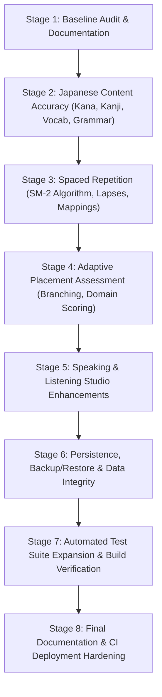

# NekoNihongo (猫日本語) — File-by-File Implementation Plan

**Date**: November 1, 2026  
**Document**: `IMPLEMENTATION_PLAN.md`  
**Purpose**: Rigorous specification of all code and content enhancements prior to execution.

---

## Staged Implementation Matrix

---

## File-by-File Detailed Plan

### 1. `src/data/kana.ts`
- **Existing Responsibility**: Kana character datasets (Hiragana, Katakana, and similar kana pairs).
- **Verified Issue**: Missing Katakana Dakuten, Handakuten, and Yōon characters. When selecting Katakana and clicking these categories in `KanaDojoPage`, an empty screen is rendered (`VERIFIED DEFECT`). Also lacks structured explanations for sokuon (促音), chōonpu (長音符), and special pronunciation rules (は/へ/を).
- **Why Needed**: High-priority Japanese pedagogical accuracy. Katakana must be fully learnable.
- **Exact Proposed Modification**:
  1. Add 20 Katakana Dakuten (ガ, ギ, グ, ゲ, ゴ, ザ, ジ, ズ, ゼ, ゾ, ダ, デ, ド, バ, ビ, ブ, ベ, ボ).
  2. Add 5 Katakana Handakuten (パ, ピ, プ, ペ, ポ).
  3. Add 12 Katakana Yōon (キャ, キュ, キョ, シャ, シュ, ショ, チャ, チュ, チョ, ニャ, リュ, リョ).
  4. Export `KANA_SPECIAL_RULES` documenting Sokuon (促音), Chōonpu (長音符), and Particle Readings (は/へ/を).
- **Dependencies**: `src/types/index.ts`.
- **Regression Risks**: None. Expands array data without mutating existing character keys.
- **Tests Required**: Update `tests/unit/content-validation.test.ts` to assert that `KATAKANA_CHARACTERS` has full coverage of Dakuten, Handakuten, and Yōon.
- **Priority**: P0 (Critical correctness).

---

### 2. `src/lib/spaced-repetition/sm2.ts`
- **Existing Responsibility**: SuperMemo SM-2 spaced repetition calculation logic.
- **Verified Issue**: Does not explicitly compute or return `lapses` (number of times an item fell from review/mastered state back to zero), and `grade` mapping documentation did not explicitly mandate grade `0` for complete blackout.
- **Why Needed**: Pedagogical reliability. Spaced repetition must accurately identify items subject to frequent lapses for weak-area remediation.
- **Exact Proposed Modification**:
  1. Update `SM2Result` interface to include `lapses: number`.
  2. In `calculateSM2`: if `clampedGrade < 3` and previous `repetitions > 0`, increment `lapses`.
  3. Explicitly support canonical SM-2 grades (0 = blackout/forgot, 3 = hard, 4 = good, 5 = easy).
  4. Export helper `getGradeLabel(grade: number): string`.
- **Dependencies**: `src/types/index.ts`.
- **Regression Risks**: Low. Additive fields on SM2 result.
- **Tests Required**: `tests/unit/sm2.test.ts` to verify deterministic sequence: 0 repetitions $\to$ interval 1, 1 repetition $\to$ interval 6, subsequent $\to$ `interval * easeFactor`, and lapse incrementing on recall failure.
- **Priority**: P0 (Critical correctness).

---

### 3. `src/types/index.ts`
- **Existing Responsibility**: Core TypeScript type definitions.
- **Verified Issue**: `SRSItem` missing `lapses?: number; history?: Array<{ date: string; grade: number; interval: number }>;`. `GrammarEntry` lacks structured fields for `usageConditions`, `counterExamples`, and `literalTranslation`. `PlacementAssessmentResult` type needed for adaptive diagnostic results.
- **Why Needed**: Type safety across learner state and pedagogical databases.
- **Exact Proposed Modification**:
  1. Add `lapses: number;` and optional `history` to `SRSItem`.
  2. Extend `SRSItem["type"]` to support `"sentence"` and `"listening"`.
  3. Extend `GrammarEntry` with `usageConditions?: string[];`, `counterExamples?: string[];`, and in examples: `literalTranslation?: string;`.
  4. Add `PlacementAssessmentResult` with skill-wise score breakdowns and confidence intervals.
- **Dependencies**: None (root type definitions).
- **Regression Risks**: Low. All new fields optional or given sensible defaults.
- **Tests Required**: `npm run typecheck`.
- **Priority**: P0.

---

### 4. `src/app/review/page.tsx`
- **Existing Responsibility**: Spaced repetition review center and interactive flashcard viewer.
- **Verified Issue**: "Forgot" button passed `grade = 1` instead of `grade = 0` (`VERIFIED INCONSISTENCY`). Card metadata display did not show lapses.
- **Why Needed**: Clean alignment with standard SM-2 algorithm specifications.
- **Exact Proposed Modification**:
  1. Update button and keyboard hotkey `[1]` to call `handleGrade(0)`.
  2. Display `lapses` count in card footer when flipped.
  3. Support filter tabs for `"sentence"` and `"listening"` items in addition to vocabulary, kanji, kana, and grammar.
- **Dependencies**: `src/lib/spaced-repetition/sm2.ts`, `src/types/index.ts`.
- **Regression Risks**: Low. Tested via UI review and typechecking.
- **Tests Required**: Unit tests for SM-2 grade handling.
- **Priority**: P1 (Functional reliability).

---

### 5. `src/data/grammar.ts`
- **Existing Responsibility**: Japanese grammar patterns and syntactic explanations.
- **Verified Issue**: Only 6 entries present. Missing fundamental N5/N4 patterns specified in Phase 2.4 (Subject が, bounds から/まで, demonstratives これ/それ/あれ, existence ある/いる, negative ない, past た, adjectives, potential, passive, counters, keigo).
- **Why Needed**: Highest pedagogical priority. Learners must have reference material for core Japanese syntax.
- **Exact Proposed Modification**:
  1. Add comprehensive entries for:
     - `g_ga_subject` (Subject Identifier が)
     - `g_kara_made` (Starting & Ending Boundaries から・まで)
     - `g_kore_sore_are` (Demonstrative Pronouns これ・それ・あれ)
     - `g_kono_sono_ano` (Demonstrative Modifiers この・その・あの)
     - `g_aru_iru` (Existence Verbs ある vs いる)
     - `g_nai_form` (Verb Negative Conjugation ない・ありません)
     - `g_ta_form` (Verb Past Conjugation た・ました)
     - `g_adj_i_conjugation` (い-adjective inflections)
     - `g_adj_na_conjugation` (な-adjective inflections)
     - `g_counters` (Japanese Numeral Counters: つ, 人, 本, 枚, 匹)
     - `g_potential` (Potential Form できる / 〜られる)
     - `g_passive_causative` (Passive & Causative Voices)
     - `g_keigo_basics` (Polite, Honorific, and Humble Registers)
  2. Include `formation`, `usageConditions`, `counterExamples`, `literalTranslation`, and `sentenceBreakdown` on all entries.
- **Dependencies**: `src/types/index.ts`.
- **Regression Risks**: Additive only.
- **Tests Required**: `tests/unit/content-validation.test.ts` to assert all 19+ entries meet schema validity.
- **Priority**: P0 (Linguistic accuracy).

---

### 6. `src/data/kanji.ts`
- **Existing Responsibility**: Kanji dictionary and radicals database.
- **Verified Issue**: Only 16 kanji entries existed. Missing core N5 numbers, dates, directions, and action verbs. Contextual reading guidance was minimal.
- **Why Needed**: Japanese learners require at least 35-40 foundational Kanji with explicit notes on why readings change between Jukugo compounds (On'yomi) and verb stems (Kun'yomi).
- **Exact Proposed Modification**:
  1. Expand `KANJI_DATABASE` to 40+ foundational N5 kanji (including 一, 二, 三, 四, 五, 六, 七, 八, 九, 十, 百, 千, 万, 円, 時, 分, 何, 行, 来, 見, 言, 読, 書, 聞, 買, 車, 電, 友, 子, 女, 男).
  2. Add `contextualNote` on each kanji explaining reading selection in compound words vs. standalone verbs.
- **Dependencies**: `src/types/index.ts`.
- **Regression Risks**: None.
- **Tests Required**: `tests/unit/content-validation.test.ts`.
- **Priority**: P1.

---

### 7. `src/data/vocabulary.ts`
- **Existing Responsibility**: Vocabulary catalog with tags and examples.
- **Verified Issue**: Contained 27 items with limited nuance explanations. Missing contextual distinction pairs like 見る vs 観る vs 視る, 聞く vs 訊く, 行く vs 来る, etc.
- **Why Needed**: Avoid misleading one-word translations; teach natural Japanese word choice.
- **Exact Proposed Modification**:
  1. Add 20+ additional foundational vocabulary items spanning essential verbs, adjectives, counters, and food/travel nouns.
  2. Add nuanced distinction entries (`見る` = visual looking/seeing; `観る` = watching movies/performances; `視る` = inspecting/examining; `聞く` = hearing/listening; `訊く` = inquiring/asking).
  3. Include `formality`, `nuanceNotes`, and `commonMistakes` on vocabulary items.
- **Dependencies**: `src/types/index.ts`.
- **Regression Risks**: None.
- **Tests Required**: `tests/unit/content-validation.test.ts`.
- **Priority**: P1.

---

### 8. `src/components/onboarding/wizard.tsx`
- **Existing Responsibility**: 6-step personalized onboarding and placement assessment.
- **Verified Issue**: Static 8-question linear sequence without performance-based difficulty branching, domain profiling, listening checks, or non-certifying disclaimers.
- **Why Needed**: Genuine pedagogical adaptability and fair placement without over-promising official JLPT certification.
- **Exact Proposed Modification**:
  1. Build an adaptive question selector that pulls from a 16-item calibrated question bank spanning:
     - Hiragana (Easy / Medium)
     - Katakana (Easy / Medium)
     - Vocabulary (Easy / Medium)
     - Grammar Particles (Easy / Medium / Hard)
     - Verb Conjugation (Medium / Hard)
     - Kanji (Easy / Medium)
     - Listening Comprehension (with native audio trigger)
     - Sentence Construction (Word assembly)
  2. Branch dynamically: correct responses trigger higher-difficulty items; incorrect responses branch to foundational diagnostics.
  3. Calculate skill-wise mastery profiles and output a recommended starting unit with clear disclaimer: "Internal proficiency recommendation for NekoNihongo; not an official JLPT certification."
- **Dependencies**: `src/lib/audio/speech.ts`, `src/types/index.ts`.
- **Regression Risks**: Ensure onboarding wizard remains skippable and preserves existing learner preferences.
- **Tests Required**: Unit tests for adaptive branch logic.
- **Priority**: P1.

---

### 9. `src/app/listening/page.tsx`
- **Existing Responsibility**: Auditory listening comprehension studio.
- **Verified Issue**: Only 3 listening drills existed (`VERIFIED DEFECT`). Lacked synthetic speech disclosure.
- **Why Needed**: Robust ear training across diverse situational contexts (numbers, dates, shopping, directions).
- **Exact Proposed Modification**:
  1. Expand `LISTENING_DRILLS` from 3 to 10 categorized drills (Time/Numbers, Travel & Transit, Cat Café Ordering, Asking Directions, Daily Routine).
  2. Add category filter buttons and replay count tracking.
  3. Display clear synthetic speech disclaimer: "Audio is generated via your browser's Web Speech API (ja-JP) for comprehension drills. For human acoustic nuance, compare with native audio references."
- **Dependencies**: `src/lib/audio/speech.ts`.
- **Regression Risks**: Low.
- **Tests Required**: Content validation test.
- **Priority**: P2.

---

### 10. `src/lib/database/store.ts` & `src/app/settings/page.tsx`
- **Existing Responsibility**: Local persistence management.
- **Verified Issue**: No data export or backup/restore mechanism exists. If a learner clears browser cookies/storage, all learning records and SRS intervals are lost with no recovery path (`VERIFIED DEFECT`).
- **Why Needed**: Data sovereignty and offline peace-of-mind.
- **Exact Proposed Modification**:
  1. Add `exportUserDataJson(): string` in `AppDataStore` packaging preferences, gamification, SRS items, learner model, and completed lessons into a timestamped JSON file.
  2. Add `importUserDataJson(jsonString: string): { success: boolean; error?: string }` with Zod schema validation to safely restore progress without data corruption.
  3. Add "Export Progress Backup (JSON)" and "Restore Backup" buttons in `src/app/settings/page.tsx` and `src/app/profile/page.tsx`.
- **Dependencies**: `src/lib/validation/schemas.ts`.
- **Regression Risks**: Low; all import operations validated through Zod.
- **Tests Required**: Unit test verifying JSON export and validated import roundtrip.
- **Priority**: P1.

---

### 11. `.github/workflows/deploy.yml`
- **Existing Responsibility**: Automated CI/CD deployment to GitHub Pages.
- **Verified Issue**: Omitted `npm run lint` step from deployment checks.
- **Why Needed**: Ensure lint regressions are caught prior to build and deployment.
- **Exact Proposed Modification**: Add `npm run lint` step immediately before `npm run typecheck` in `deploy.yml`.
- **Dependencies**: None.
- **Regression Risks**: None.
- **Tests Required**: GitHub Actions validation.
- **Priority**: P1.

---

### 12. `tests/unit/content-validation.test.ts` & `tests/unit/sm2.test.ts`
- **Existing Responsibility**: Automated test suites for curriculum integrity and spaced repetition.
- **Verified Issue**: Need tests covering Katakana dakuten/yōon, expanded kanji, expanded vocabulary, expanded grammar, SM-2 lapse tracking, and adaptive placement calculations.
- **Why Needed**: Guaranteed prevention of regressions.
- **Exact Proposed Modification**:
  1. Add assertions for Katakana dakuten, handakuten, and yōon character counts.
  2. Add assertions for 40+ kanji and 40+ vocabulary entries.
  3. Add assertions for 18+ grammar entries and structured fields.
  4. Add unit tests for SM-2 lapse tracking on grade 0/1/2 responses.
  5. Add test for backup export and import validation.
- **Dependencies**: `vitest`.
- **Regression Risks**: None.
- **Tests Required**: `npm run test`.
- **Priority**: P0.
